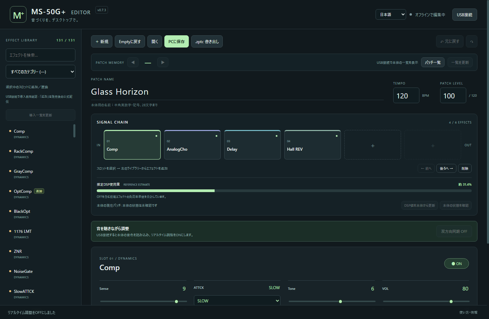

# MS50GPlus-Editor

**MS-50G+の音づくりを、Windowsの画面で。**

[English](README.en.md) · [ダウンロード](https://github.com/suigin10/MS50GPlus-Editor/releases) · [使い方](docs/USAGE.ja.md)

ZOOM MS-50G+専用の非公式パッチエディターです。音を聴きながらPCで調整し、本体の操作も画面へ反映できます。日本語／英語UIに対応した、インストール不要のWindows x64向けアプリです。



## 主な機能

- パラメーター、エフェクトON/OFF、テンポ、音量の双方向同期
- 001〜100のパッチ一覧・番号／名前検索・前後切り替え
- 最大6エフェクトの編集、並べ替え、パッチ名変更
- 公式129エフェクトと補助2モジュールのライブラリー、導入状況・追加エフェクトの表示
- エフェクトの負荷基準値から計算する推定DSPバー
- PCへのプロジェクト保存、`.zptc`の読み書き、全100パッチのバックアップ
- Emptyへの初期化、Undo/Redo、日本語メモ

## 起動する

1. [Releases](https://github.com/suigin10/MS50GPlus-Editor/releases)から`win-x64.zip`をダウンロードします。
2. 書き込み可能なフォルダーへ、ZIP全体を展開します。
3. `MS50GPlus-Editor.exe`を起動します。

実行時にNode.js、Python、ブラウザーの準備は不要です。実行ファイルだけを移動せず、同梱ファイルと一緒に使ってください。作業の自動復旧データと言語設定は、実行ファイル横の`data`フォルダーに保存されます。

## 本体と使う

USBデータケーブルで本体をつなぎ、「USB接続」でMS-50G+の入出力を選びます。接続すると現在の音色を読み込み、双方向同期がONになります。

本体への保存先は、上部の**PATCH MEMORY**の番号です。「011 に保存」などの番号付きボタンで保存します。「PCに保存」は、音色とメモをPCのファイルへ保存する操作です。本体のAUTO SAVEがONなら、調整内容も本体へ自動保存されます。

操作の詳細は[日本語ガイド](docs/USAGE.ja.md)を参照してください。

## 対応範囲

- Windows x64、MS-50G+。本体との連携はFW 1.40で確認しています。
- 音声処理は本体で行います。PC単体の音源やUSBオーディオ機能ではありません。
- DSPバーは負荷基準値の合計による推定値です。
- ファームウェア更新、エフェクトのインストール、旧MS-50Gや他機種の編集は対象外です。

アプリは未署名です。大切なパッチは、編集前に全パッチのバックアップを保存してください。

## 開発

Node.js 24推奨。依存関係の取得にはインターネット接続が必要です。

```sh
npm ci
npm test
npm start
```

`npm run package`でWindows向けのフォルダーを生成します。詳細は[開発ガイド](CONTRIBUTING.md)を参照してください。

## ライセンス・クレジット

[MIT License](LICENSE)。第三者コードの著作権・ライセンスは[THIRD-PARTY-NOTICES.txt](THIRD-PARTY-NOTICES.txt)と`vendor`内のライセンスを参照してください。

- Thomas Hammer / [zoom-explorer](https://github.com/thammer/zoom-explorer)：パッチ形式、ヘルパー、パラメーターマッピング
- mungewell / [zoom-zt2](https://github.com/mungewell/zoom-zt2)：DSPメタデータの換算方法
- 参考アプリ：[sym.bios.is](https://sym.bios.is/)

本アプリはZOOM CORPORATIONの公式製品ではありません。メーカーのファームウェア、エフェクト実行ファイル、マニュアル、音声データは同梱していません。
